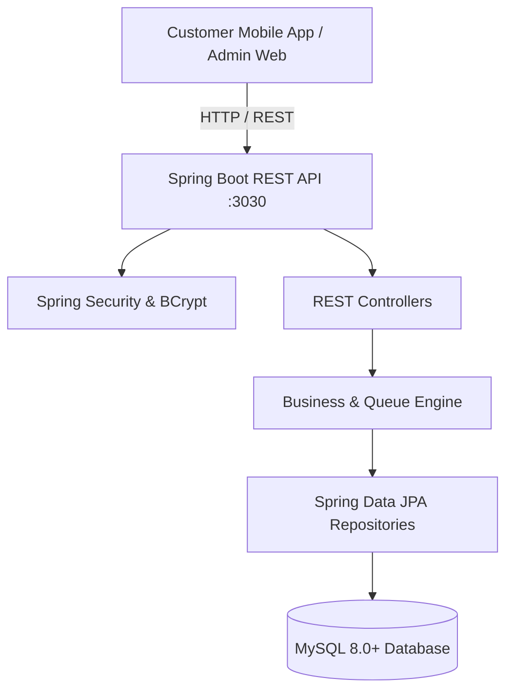

# ORDEXA System Architecture

## Core Modules & Data Flow

1. **Queue Engine (`com.ordexa.queue`):**
   - Handles token numbering sequences, unique prefix formatting (e.g. `ORG-SRV-001`).
   - Implements FIFO (First In, First Out) counter assignments based on active service mappings.
   - Calculates waiting time dynamically based on average duration multiplied by preceding tokens.

2. **Counter Dispatch:**
   - Multi-counter support where multiple counters can serve the same service (load balancing), or a single counter handles specialized services.
   - Supports states: `WAITING` -> `SERVING` -> `COMPLETED` / `CANCELLED` / `HOLD`.

3. **Touchless Kiosk & QR Integration:**
   - Pre-encoded QR codes link directly to organization/service IDs allowing instant browser token issuance without downloading an app.
